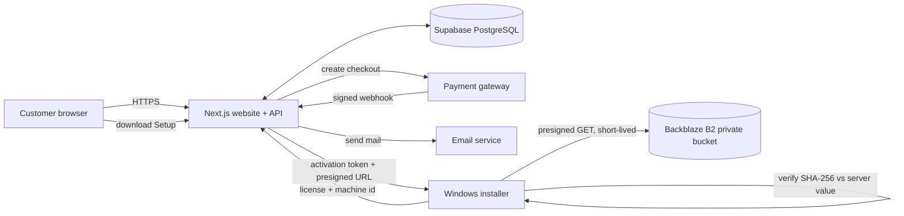

# 03 — Production Architecture

> Evidence labels: doc 01 §0. Everything below is **PROPOSED DESIGN** unless labelled otherwise. Items needing client choice are marked REQUIRES CLIENT CONFIRMATION.

## 1. Goals and constraints
- Meet the agreement scope (doc 17) with the stack the brief names: Next.js + TypeScript, Supabase PostgreSQL + Prisma, Backblaze B2 (client confirmed 2026-10-24).
- No customer accounts. Customer email + license key are the only customer-facing identifiers.
- Private packages; all downloads backend-authorized and short-lived.
- Avoid unnecessary provider lock-in (database portability) without building abstraction frameworks.
- Honest security claims: reasonable measures, no guarantee against circumvention (§08.2).

## 2. Components
| Component | Responsibility | Notes |
|---|---|---|
| Public website (Next.js App Router) | Home, 14 product pages (13 agreement categories; doc 13), purchase pages, info pages, FAQ, install guide, contact | Static/SSG where possible for SEO. Reuse nothing from the prototype UI except what the audit marks reusable. |
| Backend API (Next.js route handlers) | Checkout, payment webhook, license issue, activation, package authorization, recovery, contact | All sensitive logic server-side only. |
| Database (Supabase PostgreSQL via Prisma) | Customers, products, packages, orders, payments, licenses, activations, audit events | No binaries stored. |
| Object storage (Backblaze B2, private) | Driver packages + installer artifacts | Access only via backend-signed URLs (S3-compatible API). |
| Payment gateway | Takes payment; sends signed webhooks | **Razorpay** (stated by developer; written client confirmation and account ownership pending). |
| Email service | Order confirmation, license delivery, recovery, contact-form relay | **Provider not decided.** Business mailbox on client's domain. |
| Invoices, manuals, stickers | GST tax invoice (template supplied), per-product manual PDF and printable sticker PDF delivered with the license email; WhatsApp delivery | Invoice fields and tax handling **REQUIRE CLIENT CONFIRMATION** (C-13, C-34); WhatsApp mechanism unconfirmed (C-14). |
| Windows installer (Setup) | Collect license, compute machine ID, activate, download, verify, install, clean up. Existing C# bootstrapper is the base; it must be hardened (doc 07). The client's own MSKLC `setup.exe` is not used. | See doc 07. |
| Analytics (§12.4) | Language-specific sales reporting | Derived from orders; no third-party tracker required. |

## 3. Diagram

## 4. Trust boundaries
1. **Browser / installer ↔ backend:** untrusted clients; every request validated, rate-limited, authorized.
2. **Backend ↔ payment gateway:** only a verified webhook (or server-to-server status fetch) can mark an order paid. Browser redirects are never proof of payment.
3. **Backend ↔ Backblaze B2:** B2 credentials live only in server env; clients receive only time-limited signed URLs.
4. **Backend ↔ DB:** server-side only; DB not exposed publicly except via backend (Supabase RLS/keys: see doc 11).
5. **Installer binary:** treated as fully attacker-readable; secrets inside it provide no real confidentiality (doc 07 §6).

## 5. Key data flows
- **Purchase:** product → name/email → gateway → webhook (verified, idempotent) → order PAID → license issued → email.
- **Activation:** license + machine ID → validate (status, product, activation limit) → signed token → package authorization → presigned URL → download → SHA-256 vs DB value → install.
- **Recovery:** email request → generic response → email to purchase address only → re-authorization (doc 09).

## 6. Deployment topology
- Production host: **REQUIRES CLIENT CONFIRMATION.** Agreement says deployment to the *client's approved hosting* (§02.5). Prototype is on Vercel. If Vercel is retained, the client must own/pay the account and use a plan whose terms permit commercial use (verify current Vercel terms).
- Domain `brahmicomputing.in` + `www`: HTTPS enforced, HSTS after validation.
- Separate **staging** and **production** environments with separate DB, Backblaze B2 bucket, gateway test/live keys.

## 7. Decisions and reasons
| Decision | Reason |
|---|---|
| Server-side only trust for payment, license, package authorization | Client code is modifiable. |
| Presigned URLs from backend, bucket private | Meets §02 "private software storage / temporary download". |
| Expected SHA-256 stored in DB per package (computed at packaging time), not read from the bucket | Trusted source independent of storage. |
| Thin storage module (get-signed-url, head-object) rather than a framework | Clean S3-compatible interface to Backblaze B2 without over-engineering. |
| Plain Prisma + standard SQL types; avoid Supabase-only features in business logic | Eases future DB migration (brief §3). Supabase Auth/Realtime not used. |
| No customer login | Agreement/brief; recovery uses email-based flows. |
| Audit events table | Supports dispute/refund/recovery investigation. Justified in doc 04. |

## 8. Website design principles
KISS and distinctive. Client-final palette: `#E51055`, `#FFFFFF`, with `#0066CC` for links and similar uses; no other brand colours (doc 01 §10). Architecture consequences: server-rendered pages, content in typed files, prices only from the database, no UI framework beyond what is needed, theme tokens in one file (`src/app/globals.css`), and a build check (`scripts/check-placeholders.ts`) that fails a production build while any PLACEHOLDER content remains. Logos (SVG) supplied by the client (`public/logos/`) are used as-is; fonts only after licence confirmation (doc 13 §4).

## 9. Changes forced by the existing-system audit (doc 02)
- The prototype's purchase, recovery, validation and download routes are **not reusable as-is**: they issue or reveal licenses without payment or proof (F-04, F-05, F-06). They are replaced by the flows in docs 05–07; existing route paths may be kept only where behaviour is rebuilt.
- Signing and HMAC secrets in source (F-01, F-02) are replaced by environment-only keys with a key id; **new key pairs must be generated** and the old ones treated as compromised.
- Package definitions move from source code (`b2.ts`) to the database (`ProductPackage`), per product and architecture.
- Unknown products must fail with an error, never fall back to another product (F-08).

## Phase 2 Foundation Status (VERIFIED BY TEST)
- Foundation services implemented: `env.ts` (typed server-only), `storage.ts` (Backblaze B2 confirmed storage with 15m presigned GET cap), `rate-limiter.ts` (DB-backed fixed window), `logger.ts` (structured redacting), `audit.ts` (immutable audit trail).
- Automated test suite: 19/19 tests passing across unit and integration tests.

## Phase 3 Website Status (VERIFIED BY TEST)
- Full agreed website implemented: Home (`/`), Products Catalog (`/products`), 13 Category Pages (`/products/[slug]`), Installation Guide (`/instructions`), FAQ (`/faq`), Brahmi Story (`/story`), Fonts & Resources (`/resources`), Contact with working form (`/contact`), and Restyled Recovery (`/recover`).
- Typed content hierarchy in `src/content/` with strict `check:placeholders` enforcement.
- Dynamic metadata routes: `src/app/sitemap.ts` and `src/app/robots.ts`.
- Security baseline: HTTP security headers in `next.config.mjs` (CSP, HSTS, X-Content-Type-Options, X-Frame-Options, Referrer-Policy, Permissions-Policy).
- Automated test suite: 34/34 tests passing across 12 test suites. Lighthouse mobile scores: Home (99/94/96/100), Product (99/96/96/100).

